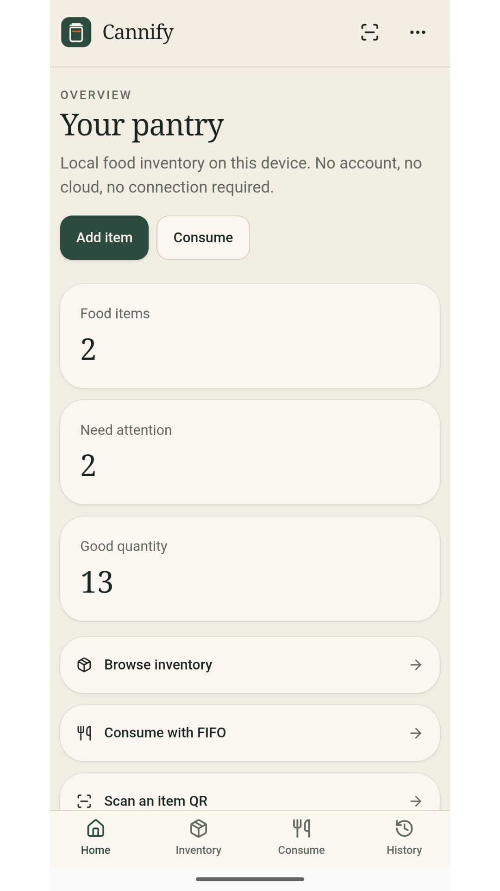
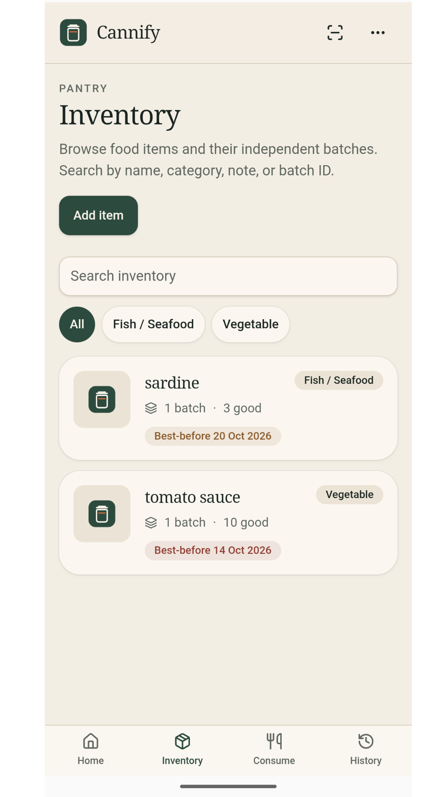
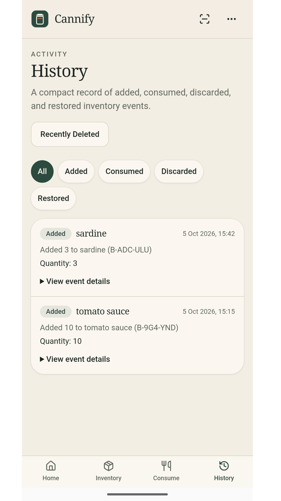
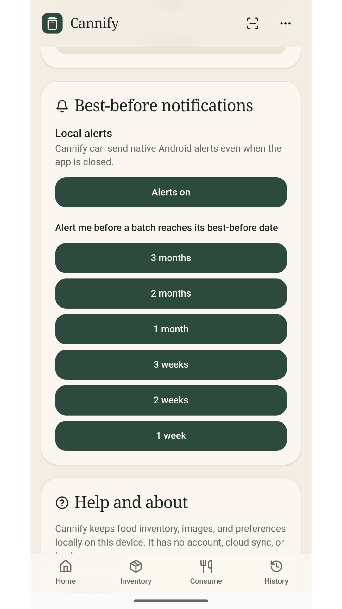
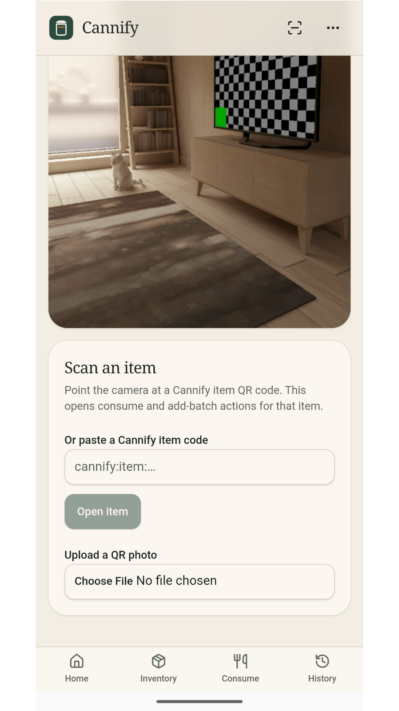

# Cannify — Offline Food Inventory Management

Cannify is an offline-first food inventory management app for Android phones and tablets. It helps you organize home-preserved foods, pantry supplies, and other stored food items while tracking batches, quantities, production dates, and best-before dates.

Designed for local use, Cannify keeps inventory management on your device without requiring an account or cloud-based inventory service.

## Features

- **Food inventory management** — Organize food items with names, photos, categories, and batch information.
- **Batch-level tracking** — Record production dates, best-before dates, quantities, and notes for individual batches.
- **FIFO consumption** — First-In, First-Out logic prioritizes older batches when consuming inventory.
- **QR code support** — Generate and scan item QR codes to access inventory items and their available actions.
- **Expiration reminders** — Schedule local notifications to help you keep track of approaching best-before dates.
- **Inventory history** — Review recorded additions, consumption, discards, and restoration activity.
- **Discard tracking** — Record unusable quantities and reasons for discarding food.
- **Recently Deleted** — Restore supported deleted records or permanently remove them.
- **Item photos** — Attach images to help identify stored food.
- **Offline operation** — Core inventory features are designed to work without an internet connection.

## Privacy and Data Storage

Cannify is designed for local, offline inventory management.

- Inventory data is stored locally using IndexedDB.
- No user account is required.
- No cloud synchronization service is required for core functionality.
- QR code generation and decoding are handled on-device.
- Expiration reminders use local device notifications.

**Important:** Local storage means your inventory data is associated with the device and app installation. Uninstalling the app, clearing its data, or losing the device may result in data loss. Keep any important information backed up separately if needed.

## Download and Installation

The Android installation package is available from GitHub Releases:

**[Download Cannify for Android](https://github.com/mvdesignautomation/Cannify/releases)**

1. Open the Releases page.
2. Download the available `.apk` file.
3. Open the downloaded file on your Android device.
4. If prompted, allow installation from that source in your Android settings.
5. Complete installation and open Cannify.

Android may display a warning when installing an app outside an official app store. Only install packages obtained from a source you trust.

## Technology Stack

| Component | Technology |
|---|---|
| UI framework | React 19 |
| Application framework and routing | TanStack Start and TanStack Router |
| Programming language | TypeScript |
| Styling | Tailwind CSS v4 |
| UI primitives | Radix UI |
| Icons | Lucide React |
| Android integration | Capacitor 8 |
| Local database | IndexedDB |
| QR code generation | `qrcode` |
| QR code decoding | `jsQR` with browser API support where available |
| Android package | `com.mvdesign.cannify` |

### Architecture

Cannify uses a web-based application interface packaged for Android through Capacitor. Its local database is implemented with IndexedDB, which is accessed through the app's JavaScript runtime.

Capacitor provides the bridge between the web application and Android capabilities used by features such as camera access and local notifications.

The application is designed to provide its core inventory functionality without depending on a remote backend.

## Building from Source

Cannify's source code is available in this repository.

**Prerequisites**

- Node.js and npm
- Android Studio
- Android SDK and the required build tools

**Get the source code**

```bash
git clone https://github.com/mvdesignautomation/Cannify.git
cd Cannify
```

Install the project dependencies:

```bash
npm ci
```

The project uses Vite-based tooling. Available development and Android build scripts depend on the current project configuration; inspect `package.json` for the supported commands before building.

Android builds can be opened and managed through Android Studio using the project's Android configuration.

## Project Goals

Cannify aims to make food inventory management practical for home users who want to:

- Keep track of stored food and home preserves.
- Manage multiple batches of the same item.
- Reduce waste by prioritizing older stock.
- Record consumption and discarded quantities.
- Access inventory information without relying on a cloud service.


## Repository

Source code: [mvdesignautomation/Cannify](https://github.com/mvdesignautomation/Cannify)

Downloads: [Cannify Releases](https://github.com/mvdesignautomation/Cannify/releases)

---

Cannify is an independently developed project. Feature availability and behavior depend on the published application version.

## Promotional Images


## App Gallery










